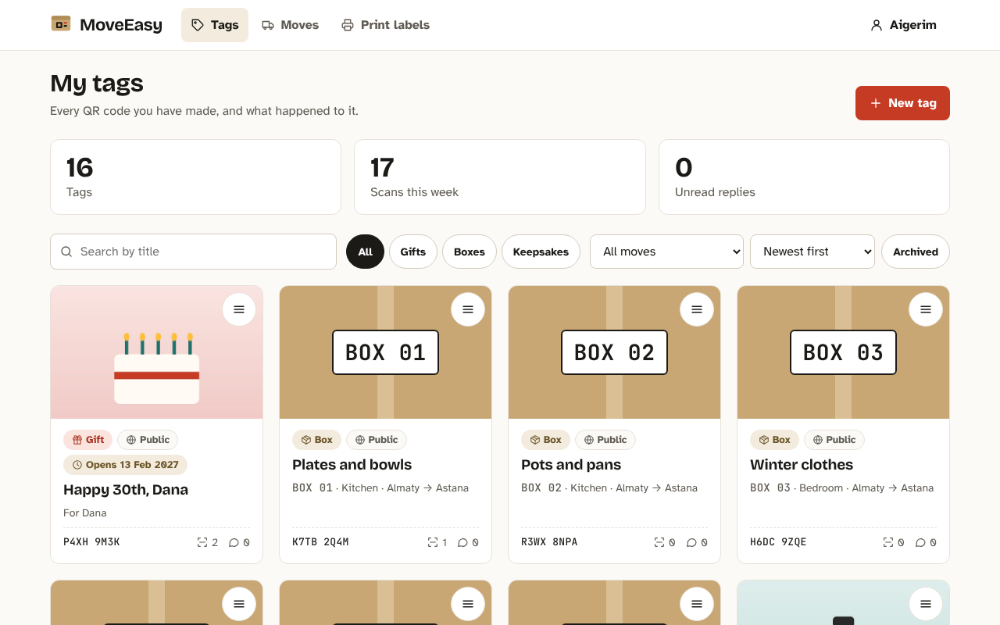
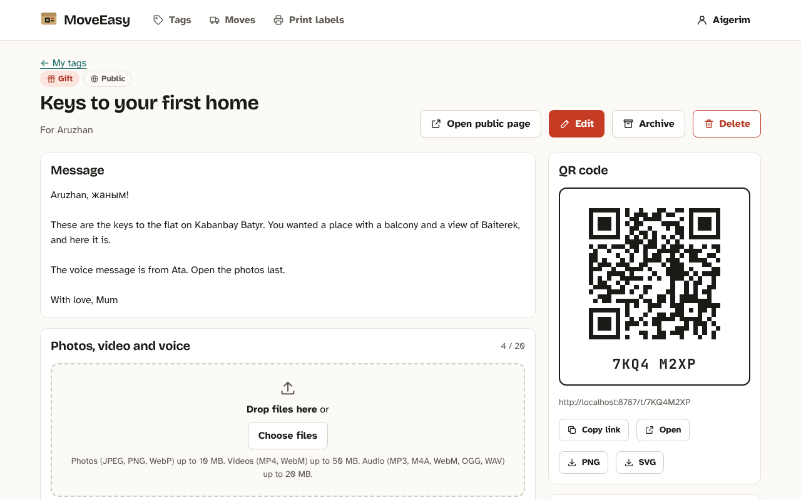
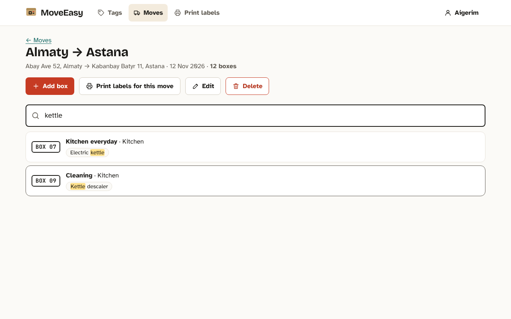
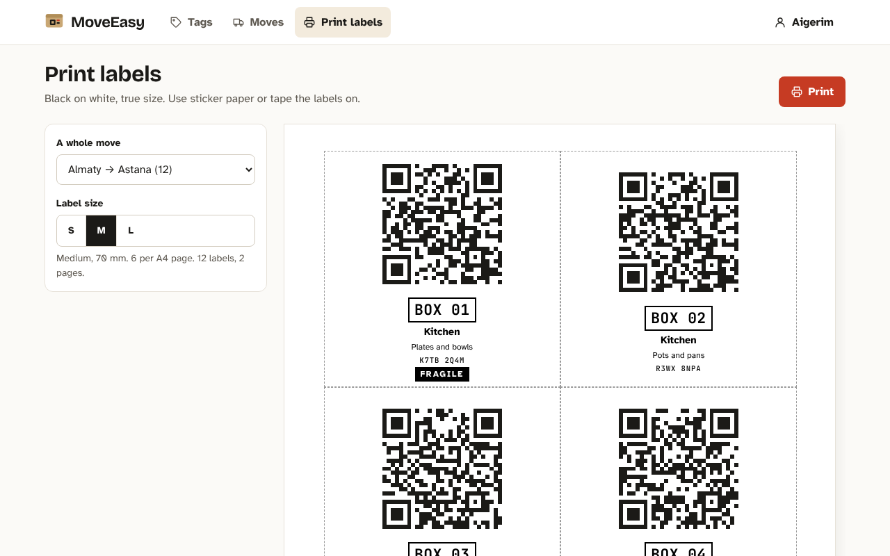
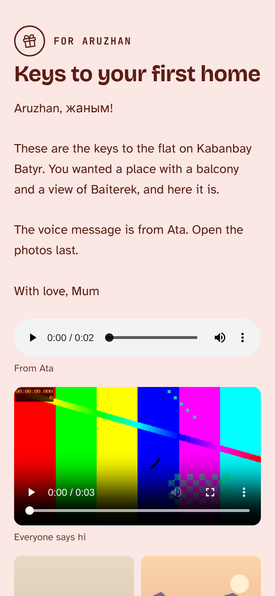
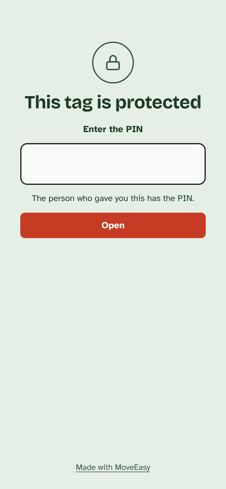
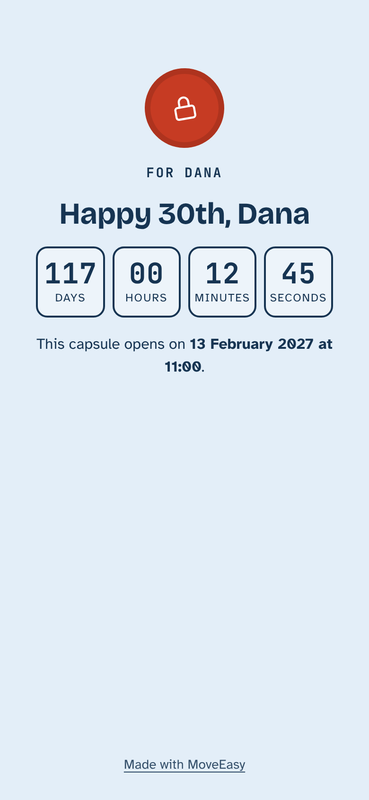

# MoveEasy Memory Tags

QR codes on gifts, moving boxes and keepsakes. Scanning one opens a page
with a message, photos, a video or a voice message. A gift can stay
locked until a date or behind a PIN; the person who scans it can send a
thank-you back. Boxes belong to a move, are numbered automatically, list
what is inside, and the move page answers "where is my kettle?". Labels
print on A4 in three sizes.

| Owner: dashboard | Owner: a tag with its QR code |
|---|---|
|  |  |
| **Moving day: "where is my kettle?"** | **Printable box labels** |
|  |  |

| Visitor: an open gift | Visitor: PIN | Visitor: opens on a date |
|---|---|---|
|  |  |  |

## Requirements

- Node.js 22 or newer (npm 10)
- Nothing else: the database is a SQLite file, uploads go to a folder

## Setup and run

```bash
npm ci          # installs every workspace and generates the Prisma client
npm run dev     # backend on :8787 + frontend on :5173, open http://localhost:5173
```

On the first start the backend creates `backend/data/moveeasy.db`, applies
the migrations and loads the demo data. Log in with a demo account:

| Email | Password | What it has |
|---|---|---|
| `aigerim@example.com` | `password123` | gifts, keepsakes, the "Almaty → Astana" move with 12 boxes |
| `dana@example.com` | `password123` | a PIN gift (`G5MK8WRT`, PIN `2468`) |

Try the visitor side without logging in: `/t/7KQ4M2XP` (open gift),
`/t/D8RW5TQN` (PIN `1971`), `/t/P4XH9M3K` (opens on a date),
`/t/S6ZE3VKA` (private).

The Vite dev server also listens on your local network, so you can open
`http://<your-computer-ip>:5173` on a phone and scan the QR codes: they
point at whatever address the page was opened from.

### Like production

```bash
npm run build   # type-checks everything and builds the frontend into frontend/dist
npm start       # one server on :8787: the API and the built app
```

Open `http://localhost:8787`. Links such as `/t/7KQ4M2XP` or
`/moves/...` open directly.

## Commands

| Command | What it does |
|---|---|
| `npm run dev` | backend and frontend together, with reload |
| `npm run dev:mock` | frontend only, on the in-browser mock service (iteration 1) |
| `npm test` | all unit, component and API tests; backend tests run twice, on the memory store and on SQLite |
| `npm run e2e` | Playwright end-to-end tests on desktop and phone sizes against a fresh database |
| `npm run build` | type-check and build |
| `npm start` | serve the built app and the API on one port |
| `npm run db:migrate` | apply Prisma migrations |
| `npm run db:seed` | **reset**: delete all data and uploaded files and load the demo data again |

## Settings

All optional.

| Variable | Default | Meaning |
|---|---|---|
| `PORT` | `8787` | backend port |
| `DATABASE_URL` | `file:<repo>/backend/data/moveeasy.db` | Prisma connection string |
| `UPLOAD_DIR` | `<repo>/backend/data/uploads` | where photos, videos and voice messages are stored |
| `MEDIA_SECRET` | a development value | key that signs media links; **set it in production** |
| `STORE` | `prisma` | `memory` keeps everything in memory (lost on restart) |
| `SEED` | `1` | `0` skips loading the demo data into an empty database |
| `STATIC_DIR` | not set (`frontend/dist` for `npm start`) | built frontend to serve |
| `VITE_API` | `http` | frontend: `mock` uses the in-browser mock instead of the backend |

To move from SQLite to Postgres, change `provider` in
`backend/prisma/schema.prisma` and `DATABASE_URL`; the code talks to the
database only through Prisma.

## How it is built

```
shared/     Zod schemas and pure rules used by both sides (privacy, PIN lockout, box search)
frontend/   React + Vite; src/api/ is the services layer: mock/ and http/ implement one interface
backend/    Express; routes use a Store interface implemented in memory and with Prisma (SQLite)
e2e/        Playwright tests
openapi.yaml  the API contract; the backend's responses are checked against it in every test
```

More: [`_docs/stack.md`](_docs/stack.md) (why this stack) and
[`AGENTS.md`](AGENTS.md) (layout, commands and rules for coding agents).

## How the project was made

The project combines two methods:

1. **Specification-driven development with roles.** A spec
   ([`_docs/plan.md`](_docs/plan.md)) was turned into
   [GitHub issues](https://github.com/240103087/webapp/issues) labelled
   `mvp` and `post-mvp`. Each issue goes through three roles described in
   [`_docs/team/`](_docs/team): the PM grooms it
   ([`pm.md`](_docs/team/pm.md)), the engineer implements it on a branch
   ([`software-engineer.md`](_docs/team/software-engineer.md)), QA tests it
   and closes it ([`qa-engineer.md`](_docs/team/qa-engineer.md)). The
   lifecycle is in [`_docs/process.md`](_docs/process.md); issue shapes in
   [`_docs/task-template.md`](_docs/task-template.md) and
   [`_docs/bug-template.md`](_docs/bug-template.md).
2. **Frontend first, then the backend, in iterations.**
   1. The whole UI on a mock service, so it could be used and tested
      before any server existed
   2. `openapi.yaml`, the contract, written from the mock's interface
   3. The backend with an in-memory store, tested against the contract
   4. The same backend on SQLite through Prisma
   5. The frontend switched to the real backend, plus end-to-end tests

Bugs found by using the app in a real browser were filed as issues
labelled
[`user-test-bug`](https://github.com/240103087/webapp/issues?q=label%3Auser-test-bug),
groomed by the PM, given test cases by QA, fixed and closed by QA.

The visual design follows [`_docs/design-system.md`](_docs/design-system.md).
The brainstorm that picked the idea is in
[`chat-brainstorm.md`](chat-brainstorm.md). Testing rules:
[`_docs/testing-guidelines.md`](_docs/testing-guidelines.md).
