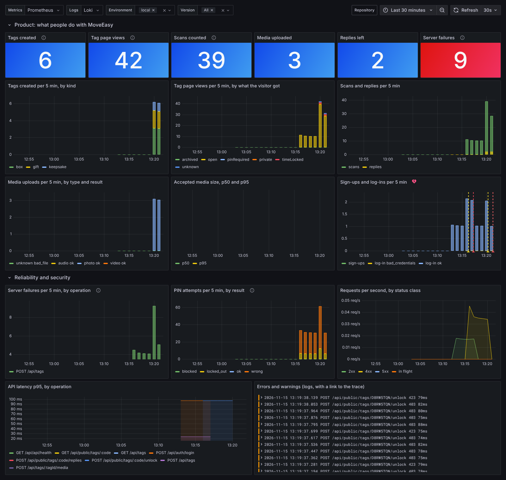
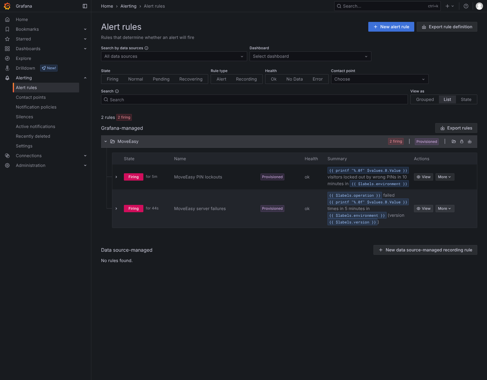

# DevOps and observability

Iteration 8 (#100), after "DevOps and Observability for an AI-Built App" (AI Dev Tools Zoomcamp, part 4).
What it adds, and where each part lives:

| Requirement | Where |
|---|---|
| Separate dev and prod environments (#101) | `render.yaml`: `moveeasy-dev` and `moveeasy-prod`, the same image |
| Manual promotion from dev to prod (#102) | `.github/workflows/promote.yml` ("Promote dev to prod") |
| OpenTelemetry metrics, traces and logs (#103) | `backend/src/telemetry/`, `observability/` |
| Application metrics and a dashboard (#104) | `backend/src/telemetry/metrics.ts`, `observability/grafana/dashboards/moveeasy.json` |
| Alerts when the metrics change (#105) | `observability/grafana/provisioning/alerting/rules.yaml` |
| An AI agent on call for the alerts (#106) | `on-call-engineer/`, `.github/workflows/on-call.yml` |

```
 push to main ──CI tests──> build the image ONCE ──> ghcr.io/240103087/webapp:20261115-130501-abc1234 (+ :dev)
                                                        │ deploy hook                     │ "Promote dev to prod" (by hand)
                                                        v                                 v
                                                  moveeasy-dev (SQLite)             moveeasy-prod (Postgres)
                                                        │ OTLP: metrics, traces, logs     │
                                                        └──────────> Grafana Cloud <──────┘
                                                                  dashboard + alert rules
                                                                         │ alert fires
                                                                         v
                                              GitHub repository_dispatch "grafana-alert"
                                                                         v
                                   on-call.yml: Claude Code investigates, fixes, tests ──> incident issue + pull request
```

## Environments and images (#101)

- CI builds the Docker image once per green commit on `main` (job "Build the image once and push it") and
  pushes it to GitHub Container Registry as `ghcr.io/240103087/webapp:<YYYYMMDD-HHMMSS-shortsha>` and `:dev`.
  The tag is baked into the image as `APP_VERSION`. A failed build stops there: deploys never build.
- Job "Deploy to dev" calls the dev service's Render deploy hook with that exact image and waits until
  `https://moveeasy-dev.onrender.com/api/health` reports the new version.
- `/api/health` answers `{ "ok": true, "environment": "dev", "version": "20261115-130501-abc1234" }`.
  `APP_ENV` is set per service in `render.yaml`.
- dev uses SQLite inside the container, with the demo data loaded on every start. prod uses the managed
  Postgres `moveeasy-db`. Both are Render's free plan (they sleep after 15 idle minutes).

## Promotion to prod (#102)

Actions > **Promote dev to prod** > Run workflow:

- **version**: empty means "the version dev runs now" (read from dev's `/api/health`); or any earlier tag, which
  is also how to roll back
- **Yes, deploy this version to production**: must be ticked
- **release** (optional, `v1.2.0`): also tags the image and creates a GitHub release for the commit

The workflow checks that the tag exists, retags it `:prod`, calls the prod deploy hook with the exact tag, waits
until prod reports it, and writes the previous version in the run summary. It uses the `production` GitHub
environment: Settings > Environments > production > Required reviewers adds an approval step.

## Telemetry (#103)

`backend/src/telemetry/instrumentation.ts` is loaded before the app (`node --import`). It does nothing unless
`OTEL_EXPORTER_OTLP_ENDPOINT` is set, so tests and `npm run dev` are unchanged. When set, it sends over OTLP:

- **Traces**: a span per API request (HTTP and Express instrumentation) with the Prisma queries under it.
  The health check and static files are not traced
- **Logs**: the request log line and server errors (with the stack) as OpenTelemetry log records, linked to the
  request's trace (`trace_id`)
- **Metrics**: the MoveEasy metrics below, and the instrumentation's HTTP metrics

Every signal has `service.name=moveeasy`, `service.version` and `deployment.environment.name`.

### Local stack

```bash
docker compose -f observability/docker-compose.yaml up -d      # Collector, Prometheus, Loki, Tempo, Grafana
docker compose -f docker-compose.yaml -f observability/app.override.yaml up --build   # the app on :8100, wired to it
# or without Docker for the app:
npm run build && OTEL_EXPORTER_OTLP_ENDPOINT=http://localhost:4318 OTEL_METRIC_EXPORT_INTERVAL=10000 npm start
```

Grafana: http://localhost:3000 (admin / admin), the MoveEasy dashboard is the home page. In Explore, a log line has
"View trace" (Loki to Tempo) and a span has "Logs for this span".

### Grafana Cloud (dev and prod)

The Render services send straight to Grafana Cloud's OTLP gateway (free tier). Set on both services, in the
Render dashboard (Environment), from Grafana Cloud > your stack > OpenTelemetry > Configure:

| Variable | Value |
|---|---|
| `OTEL_EXPORTER_OTLP_ENDPOINT` | `https://otlp-gateway-prod-<region>.grafana.net/otlp` |
| `OTEL_EXPORTER_OTLP_HEADERS` | `Authorization=Basic <base64 of instanceId:token>` (Grafana shows it ready to copy) |

Then Actions > **Set up Grafana** puts the dashboard, the alert rules, the contact point and the notification
policy into the stack (`observability/grafana/provision.mjs`). It runs again by itself when those files change.

## MoveEasy metrics (#104)

All counters have `environment` and `version` labels. In Prometheus they are named `moveeasy_..._total`.

| Metric | Labels | What it says |
|---|---|---|
| `moveeasy.tags.created` | `kind` | gifts, boxes and keepsakes created |
| `moveeasy.tag.views` | `state` | public tag pages loaded, by what the visitor got: open, pinRequired, timeLocked, private, archived, unknown |
| `moveeasy.tag.scans` | `kind` | scans counted (one per visitor per tag per 30 minutes) |
| `moveeasy.pin.attempts` | `result` | ok, wrong, locked_out (the 5th wrong PIN), blocked (tried while locked) |
| `moveeasy.media.uploads` | `type`, `result` | uploads accepted (`ok`) or rejected with their error code |
| `moveeasy.media.upload.size` | `type` | histogram of accepted file sizes |
| `moveeasy.replies.created` | | replies visitors left |
| `moveeasy.users.signups`, `moveeasy.users.logins` | `result` | accounts and log-ins |
| `moveeasy.operation.failures` | `operation` | requests that ended in an unexpected 500, by route template (`POST /api/tags`) |
| `moveeasy.http.request.duration` | `operation`, `status_class` | API request time |
| `moveeasy.http.requests.in_flight` | | requests being handled now |

Known series start at 0 when the app starts, one failure series per API route, so the first failure already
shows in `increase()`. The dashboard (`MoveEasy`) has the product counts for the time range, five-minute counts
per kind, state and result, failures per operation, PIN outcomes, latency p95 and the error logs, with
Environment and Version filters.



## Alerts (#105)

| Alert | Fires when | Severity |
|---|---|---|
| MoveEasy server failures | more than 2 failures of one operation in 5 minutes, for 1 minute | critical |
| MoveEasy PIN lockouts | more than 5 lockouts in 10 minutes in an environment | warning |

Each alert carries `service`, `environment`, `version` (and `operation`), a summary, the dashboard panel, the
owner (this repository) and a link to this page. Checked by hand: a planted bug in `POST /api/tags` (a gift
without a recipient crashed) made both alerts fire in the local stack.



## When an alert fires

The on-call responder is an AI agent (#106): Claude Code, headless, with the instructions in
`on-call-engineer/prompt.md`. It reads the alert, finds the code for the operation, reproduces the failure with a
failing test, makes the smallest fix, runs the backend tests and writes a report with a verdict: `FIXED`,
`FALSE_POSITIVE` (code unchanged, with the reason) or `NEEDS_HUMAN`.

- **Hosted**: the Grafana contact point "MoveEasy on-call agent" posts the alert to GitHub's `repository_dispatch`
  (`grafana-alert`, a custom webhook payload). `.github/workflows/on-call.yml` opens an `incident` issue, runs the
  agent, uploads its session log, and opens a pull request `on-call/incident-<n>` with the fix and the report.
  A person reviews and merges it; the next green build goes to dev and is promoted as usual. It can be tried
  by hand: Actions > On-call agent > Run workflow, with an alert pasted
- **Local**, as in the article: `node on-call-engineer/on-call.mjs` polls the local Grafana's alert API every
  minute and runs `claude -p` once per new firing alert. Each run is saved in `on-call-engineer/sessions/`
  (alert, prompt, session log, report, the diff). Nothing is committed

A person on call checks the incident issue, the agent's pull request, and the dashboard.

## Secrets and settings

Nothing secret is in the repository.

| Where | Name | What |
|---|---|---|
| GitHub secret | `RENDER_DEPLOY_HOOK_DEV`, `RENDER_DEPLOY_HOOK_PROD` | Render > service > Settings > Deploy Hook |
| GitHub secret | `GRAFANA_URL`, `GRAFANA_TOKEN` | the stack URL, and a service account token with the Admin role |
| GitHub secret | `ONCALL_GITHUB_TOKEN` | fine-grained token, this repository: Contents, Issues, Pull requests read and write. Grafana uses it to start the workflow; the workflow uses it so CI runs on the agent's pull request |
| GitHub secret | `ANTHROPIC_API_KEY` or `CLAUDE_CODE_OAUTH_TOKEN` | for Claude Code in `on-call.yml` (`claude setup-token` gives the second) |
| GitHub variable (optional) | `DEV_URL`, `PROD_URL` | when Render gave the services other addresses |
| Render env (both services) | `OTEL_EXPORTER_OTLP_ENDPOINT`, `OTEL_EXPORTER_OTLP_HEADERS` | Grafana Cloud OTLP |
| GitHub package settings | `webapp` container: Public | so Render can pull the image without a registry login |

## Limits

- Free Render services sleep, so the first request after a pause takes about a minute, and dev's data resets
  on every deploy
- The agent proposes fixes; it never merges or deploys. A false positive is closed with its reason
- The AWS deploy (`deploy/aws/`) is unchanged and still off (#78)
